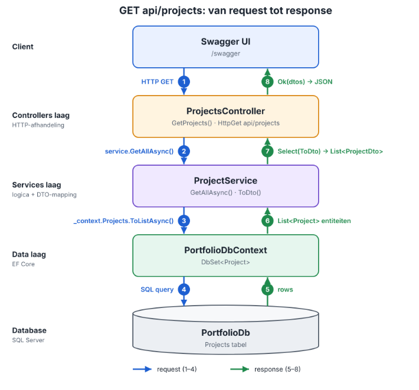

# Portfolio Backend

ASP.NET Core Web API voor het beheren van projecten en blogposts, gebouwd met controller-gebaseerde routing en EF Core als ORM naar SQL Server.

## .NET-versie

.NET 10 SDK. Controleer met:

```
dotnet --list-sdks
```

## API-stijl en codestructuur

De API gebruikt **controller-gebaseerde routing** (`[ApiController]` met attribute routes), geen Minimal API.
De code is per laag georganiseerd, met HTTP-afhandeling, applicatielogica en data-toegang herkenbaar gescheiden:

```
backend/
├── Controllers/   ProjectsController.cs, BlogpostsController.cs  (HTTP-laag)
├── Services/      ProjectService.cs, BlogpostService.cs              (applicatielogica + EF Core-toegang)
├── Data/          PortfolioDbContext.cs  (DbContext)
├── Models/        Project.cs, Blogpost.cs   (EF-entiteiten)
├── DTOs/          ProjectDto.cs, ProjectCreateDto.cs,
│                  BlogpostDto.cs, BlogpostCreateDto.cs  (invoer/uitvoer-DTO's)
├── Migrations/
├── Program.cs
└── appsettings.json
```

Projecten en blogposts volgen exact dezelfde opbouw: elk heeft een eigen controller, service en DTO-paar.

Beide entiteiten hebben vijf CRUD-routes: `GET` alle, `GET` op id, `POST`, `PUT` op id, `DELETE` op id. Controllers gebruiken alleen DTO's; de omzetting tussen entiteit en DTO gebeurt op één plek per service (`ToDto()` / `ToEntity()`).

## Lagendiagram

Hoe een request voor `GET /api/projects` door de applicatie loopt:



Blogposts volgen exact dezelfde laagindeling: `BlogpostsController` -> `BlogpostService` -> dezelfde `PortfolioDbContext` -> SQL Server, en terug als `BlogpostDto`.

## SQL Server configureren

Dit project vereist **SQL Server (Express volstaat)**, geen MySQL.

1. Installeer SQL Server Express met een **named instance**. Deze repo gaat uit van de instance-naam `SQLEXPRESS01`.
2. Pas zo nodig de connection string in `appsettings.json` aan je eigen instance-naam aan:

   ```json
   "ConnectionStrings": {
     "DefaultConnection": "Server=localhost\\SQLEXPRESS01;Database=PortfolioDb;Trusted_Connection=True;TrustServerCertificate=True"
   }
   ```

   Heb je een andere instance-naam? Overschrijf de connection string lokaal zonder de repo aan te passen:

   ```
   dotnet user-secrets init
   dotnet user-secrets set "ConnectionStrings:DefaultConnection" "Server=localhost\<jouw-instance>;Database=PortfolioDb;Trusted_Connection=True;TrustServerCertificate=True"
   ```

3. Database aanmaken (migratie wordt uitgevoerd, `PortfolioDb` wordt aangemaakt):

   ```
   dotnet ef database update
   ```

   Blogposts worden automatisch geseed via `HasData` in `PortfolioDbContext.OnModelCreating`.

## Starten

```
dotnet run
```

Swagger UI is beschikbaar op `/swagger` zodra de app draait (alleen in Development-omgeving).
